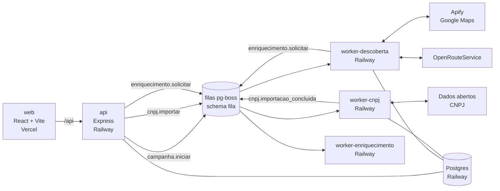

# Prospecção

Motor de prospecção por nicho + CRM, de uso interno. Encontra empresas de um nicho
(autopeças, pet shops, farmácias…) na base de CNPJ da Receita e no Google Maps,
cruza as duas fontes, localiza cada uma em relação às bases de operação e entrega
os leads prontos para o enriquecimento de contatos.

Este repositório cobre a **Fase 1** da especificação: base, descoberta e o app web
para operar campanhas e ver os leads.

## Arquitetura

Monorepo com **um serviço por domínio**. Cada serviço é um deploy separado, escala
e falha sozinho, e conversa com os outros **só por filas** (pg-boss sobre o
Postgres) e por **views publicadas**. Não há chamada HTTP entre serviços.



| Serviço | O que faz | Escreve no schema | Consome | Publica |
| --- | --- | --- | --- | --- |
| `apps/api` | Login, cadastro de nichos, campanhas e bases; leitura dos leads | `cadastro` | — | `campanha.iniciar`, `cnpj.importar` |
| `apps/worker-cnpj` | Importa todo mês a base de CNPJ filtrada por UF e CNAE | `base_cnpj` | `cnpj.importar` | `cnpj.importacao_concluida` |
| `apps/worker-descoberta` | Base de CNPJ → empresas da campanha; buscas no Maps; cruzamento; localização e raio | `descoberta` | `campanha.*`, `maps.*`, `empresa.localizar`, `cnpj.importacao_concluida` | `enriquecimento.solicitar` |
| `apps/worker-enriquecimento` | Quem decide e como falar com ele: Receita, Maps, site, Instagram, IA (nota A/B/C), LinkedIn, Places, WhatsApp | `enriquecimento` | `enriquecimento.solicitar` | — |
| `apps/web` | Interface: leads, ficha, campanhas, nichos, base CNPJ, atividade | — | — | — |

### Regras

1. **Cada schema tem um único serviço que escreve nele.** A tabela acima é a lei.
2. **Workers leem outros domínios só por views** (`packages/db/migrations/005_views_publicadas.sql`). A view é o contrato; as tabelas por trás podem mudar.
3. **Filas são o único acoplamento entre serviços.** Os contratos (nome + payload validado com zod) ficam em `packages/queue/src/contratos.ts`; quem publica e quem consome importam o mesmo tipo. Mudou o formato? Crie um job novo (`maps.buscar.v2`) em vez de alterar o antigo.
4. **Todo job é idempotente.** Pode rodar duas vezes sem duplicar nada (upserts, chaves únicas, `singletonKey` nas filas `short`).
5. **Erros dizem se vale repetir.** `AppError` com `repetivel: false` (dado inválido, recurso inexistente) encerra o job; falha externa (429, 5xx, timeout) volta para a fila com espera exponencial.

### Pacotes compartilhados

| Pacote | Conteúdo |
| --- | --- |
| `packages/config` | Leitura e validação das variáveis de ambiente (para no boot se faltar algo) |
| `packages/shared` | Contratos de entrada (zod), `AppError`, logger (pino), normalização de telefone/CNPJ/CNAE/nome, geo |
| `packages/db` | Pool do Postgres, transações, runner de migrations com lock e checksum, migrations SQL |
| `packages/queue` | Filas (pg-boss): contratos, política de cada fila, publicar/consumir com validação |
| `packages/integrations` | Apify (Google Maps), OpenRouteService, leitura dos zips da Receita |
| `packages/ui` | Design system: tokens, fontes Geist e componentes React |

Os serviços empacotam o código dos pacotes `@prospeccao/*` no build (tsup); a imagem
de produção leva só o `dist` e as dependências de terceiros daquele serviço.

## Como a descoberta funciona

1. **Iniciar campanha** (`api`) publica `campanha.iniciar`.
2. `worker-descoberta` traz da base de CNPJ os estabelecimentos **ativos** do nicho nas cidades da campanha (CNAE principal ou secundário, porte, idade mínima) e cria uma busca no Maps por **cidade × termo**.
3. Cada busca dispara um run no Apify e é conferida a cada 60 s até terminar.
4. Cada lugar do Maps é **cruzado** com a base, nesta ordem de confiança: mesmo `place_id`, mesmo telefone, nome parecido no mesmo CEP, nome muito parecido na mesma cidade. Sem par, vira empresa nova (sem CNPJ). Nome ou categoria com palavra negativa do nicho é descartado.
5. **Abrangência.** Por padrão a campanha é **nacional**: ninguém fica de fora por distância e nada é geocodificado. Se a campanha tiver **raio**, quem ainda não tem coordenada é geocodificado no ORS (com pausa para respeitar o limite gratuito) e a distância até a base mais próxima define se está na área.
6. Leads na área, abertos, de campanha ativa vão para `enriquecimento.solicitar`, uma vez cada.

## Como o enriquecimento funciona

Cascata por empresa, das fontes grátis para as que custam; cada etapa grava o que achou ou por que
foi pulada (é a trilha "Como encontramos" da ficha), e a falha de uma fonte não derruba as outras.

1. **Receita**: sócios (quem administra vem primeiro) e contatos cadastrados (e-mail de contador é marcado).
2. **Google Maps**: telefone e site que a descoberta já trouxe.
3. **Site**: home + até 3 páginas de contato/sobre: e-mails, telefones, botão de WhatsApp, Instagram, Facebook, LinkedIn e CNPJ no rodapé.
4. **Instagram**: pelo link do site ou, se não houver, procurado no Google; bio, WhatsApp e contato comercial.
5. **Nota (Gemini)**: faixa A/B/C, score e o motivo, mais pessoas citadas no site. Sem chave, nota por regras.
6. **LinkedIn** (só A e B): pessoas com os cargos-alvo do nicho e o perfil dos sócios-administradores, via busca no Google.
7. **Google Places** (só A e B, opcional): a loja segue aberta?
8. **WhatsApp** (Evolution API): quais telefones têm WhatsApp. Só consulta, não envia nada.

Decisor: quem cuida de compras, se aparecer; senão quem administra na Receita; senão um gestor citado.
Melhor contato: WhatsApp confirmado > WhatsApp do site/Instagram > telefone do Google > e-mail de compras.
A mesma empresa não é refeita antes de `ENRIQ_REFAZER_DIAS` (o botão "Enriquecer de novo" força).

## Funil comercial e relatórios

Schema `comercial` (dono: api). **Uma oportunidade por empresa**, não por campanha: a mesma loja
achada de novo (outra campanha, nova rodada) continua sendo um card só, com o histórico.

- **Leads** mostra por padrão só os **novos** (nunca mandados ao funil nem descartados). Marque e
  use *Mandar para o funil* ou *Descartar* (com motivo). Descartados não voltam como novos e não
  gastam enriquecimento de novo.
- **Contato repetido:** antes de entrar no funil, o telefone (do site, Instagram, Maps; o da Receita
  fica de fora porque costuma ser do contador) é comparado com o das empresas já trabalhadas. Igual →
  fica de fora com aviso; *Mandar mesmo assim* força.
- **Funil** (Kanban): A abordar → Abordado → Respondeu → Reunião → Proposta → Ganho / Perdido.
  Arrastar move; perder pede motivo. Na ficha: etapa, próximo passo com data (follow-up), potencial
  em R$/mês, registro de contatos (a etapa avança sozinha) e histórico.
- **Relatórios**: comercial do período (abordados, taxa de resposta, reuniões, ganhos), prospecção
  (A/B, com decisor, com WhatsApp), funil cumulativo, ritmo diário, *a nota acerta?* (resultado por
  nota de entrada), origem dos decisores (mede a falta da fonte paga), campanhas e motivos de perda.

## Rodar localmente

Requisitos: Node 22, pnpm 10 e Postgres 16 (com as extensões `pg_trgm` e `unaccent`, que vêm no pacote contrib).

```bash
pnpm install
cp .env.example .env              # preencha DATABASE_URL, ADMIN_EMAIL etc.
pnpm --filter @prospeccao/api hash-senha   # cole o resultado em ADMIN_SENHA_HASH
pnpm db:migrate
pnpm dev                          # api :3000, web :5173 e os dois workers
```

Abra http://localhost:5173. O worker-descoberta precisa de `APIFY_TOKEN` para subir; sem ele,
rode só `pnpm --filter @prospeccao/api dev` e `pnpm --filter @prospeccao/web dev`.
`ORS_API_KEY` é opcional: só campanhas com raio usam.

Primeiro uso: crie um **nicho**, crie a **campanha** (nacional por padrão; bases de operação
só são necessárias para campanhas com raio) e clique em **Importar agora** na base de CNPJ (a primeira importação baixa
alguns GB e leva de 20 a 60 minutos). Depois, **Iniciar busca** na campanha.

## Testes

```bash
pnpm typecheck
pnpm lint
TEST_DATABASE_URL=postgres://postgres@localhost:5432/prospeccao_teste pnpm test
```

Os testes de integração (api, worker-cnpj, worker-descoberta) usam um Postgres real; cada
pacote cria o próprio banco (`<nome>_api`, `<nome>_cnpj`, …), então rodam em paralelo.
Apify e ORS são simulados. Sem `TEST_DATABASE_URL`, só os testes de unidade rodam.

## Deploy

### Banco (Postgres no Railway)

No mesmo projeto dos serviços, **+ New → Database → PostgreSQL**. Em cada serviço, defina
`DATABASE_URL=${{Postgres.DATABASE_URL}}` (referência à URL privada, `*.railway.internal`).
Na rede privada a conexão vai sem TLS; o resto (Neon, URL pública) usa TLS — a regra está em
`packages/shared/src/postgres.ts`. Para acessar do seu computador, use a `DATABASE_PUBLIC_URL`
com `?sslmode=no-verify` no fim (o proxy público usa certificado autoassinado).

### Serviços (Railway)

Um projeto, três serviços apontando para este repositório, todos com o `Dockerfile` da raiz.
A variável `SERVICO` escolhe o que a imagem empacota.

| Serviço | `SERVICO` | Pre-deploy | Healthcheck | Variáveis além de `DATABASE_URL` |
| --- | --- | --- | --- | --- |
| api | `api` | `node dist/migrar.js` | `/saude` | `APP_ORIGENS`, `JWT_SEGREDO`, `ADMIN_EMAIL`, `ADMIN_SENHA_HASH`, `ORS_API_KEY` (opcional) |
| worker-descoberta | `worker-descoberta` | — | — | `APIFY_TOKEN`; opcionais: `ORS_API_KEY` (campanhas com raio) e ajustes (ver `.env.example`) |
| worker-cnpj | `worker-cnpj` | — | — | opcionais: `CNPJ_UFS_EXTRAS`, `CNPJ_AGENDA` |
| worker-enriquecimento | `worker-enriquecimento` | — | — | opcionais: `APIFY_TOKEN`, `GEMINI_API_KEY`, `EVOLUTION_URL` + `EVOLUTION_API_KEY` + `EVOLUTION_INSTANCIA`, `GOOGLE_PLACES_KEY` |

- As migrations rodam só no pre-deploy da `api`, antes da nova versão subir. Os workers não migram.
- Em "Watch paths", limite cada serviço a `apps/<serviço>/**`, `packages/**` e `pnpm-lock.yaml`, para um deploy não reiniciar os outros.
- O worker-cnpj precisa de alguns GB de disco temporário durante a importação (os zips são baixados e apagados um a um).

### Web (Vercel)

Importe o repositório com **Root Directory** `apps/web`. O `apps/web/vercel.json` já define
build, saída e o rewrite de `/api/*` para a API. **Troque `SUA-API.up.railway.app` pelo
domínio público da api no Railway.** Com o rewrite, web e API ficam na mesma origem e o
cookie de sessão (`HttpOnly`, `SameSite=Strict`) funciona sem CORS.

Depois, coloque o domínio do Vercel em `APP_ORIGENS` da api.

## Segurança

- Um usuário: e-mail e hash bcrypt vêm do ambiente; sessão em JWT num cookie `HttpOnly`, `SameSite=Strict`, `Secure` em produção.
- Escritas exigem `Origin` conhecida (`APP_ORIGENS`), além do SameSite.
- Login limitado a 10 tentativas a cada 15 min por IP; `helmet` nos cabeçalhos.
- Todo SQL é parametrizado; corpo e query validados com zod antes de chegar ao banco.

## Pendências conhecidas

- **Endereço da base da Receita:** desde 2026 a Receita publica num compartilhamento Nextcloud, lido por WebDAV: `https://arquivos.receitafederal.gov.br/public.php/dav/files/YggdBLfdninEJX9/<AAAA-MM>/`. Se mudar de novo, ajuste `RECEITA_CNPJ_URL` (aceita WebDAV ou uma pasta com listagem HTML, como os espelhos) ou baixe os zips e use `CNPJ_PASTA_LOCAL` + `CNPJ_MES_LOCAL`.
- **Opções de serviço do Maps (entrega):** o ator do Apify só traz "opções de serviço" quando abre a página de detalhes de cada lugar. Ative por `APIFY_MAPS_INPUT_EXTRA` conforme o input atual do ator (custa mais por lugar).

## Próximas fases

- **Fase 2b:** base paga para o celular do sócio (Direct Data, ~R$ 0,32/lead), plugada atrás de um teto diário e só para A/B.
- **Fase 3 · CRM:** funil, ficha completa, inbox de WhatsApp em tempo real.
- **Fase 4 · `worker-cadencia`:** cadências automáticas e proteção do chip.
- **Fase 5:** IA nas respostas e painel.
